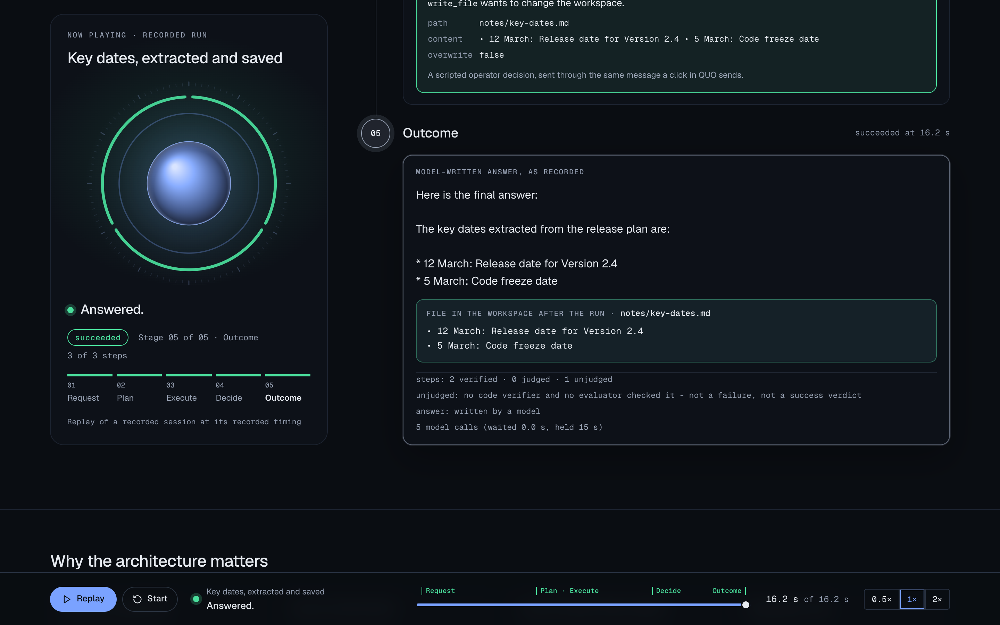
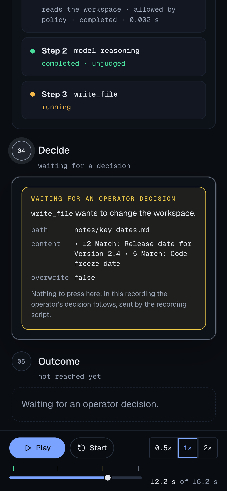
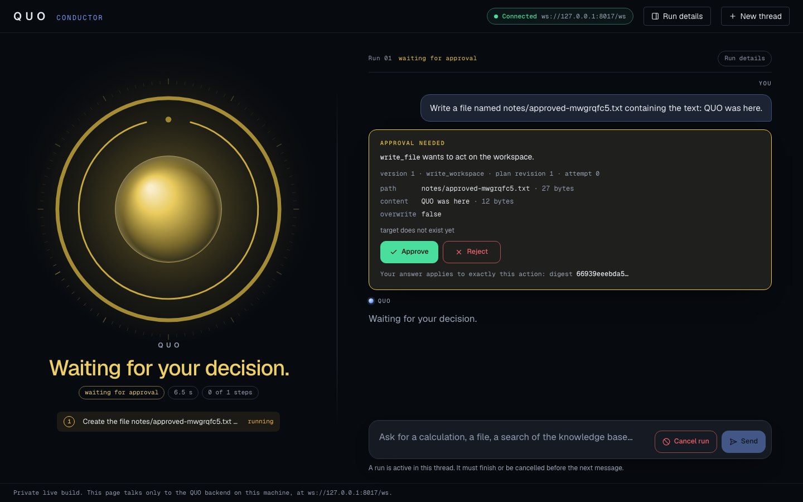

# QUO · Conductor

**QUO is a local AI orchestration runtime. It turns a request into planned tool steps, asks a person before it writes to the workspace, and records every step in a journal you can inspect.**

**[Open the interactive demo](https://erturkeryavuz.github.io/quo-conductor-demo/)** · [Walkthrough video (68 s)](media/quo-walkthrough.mp4)


## The problem

A chat assistant can say what it would do. An agent that can act needs more than that: a plan you can read, tools that run within declared limits, a person's sign-off before anything changes, and a record you can check afterwards. QUO is built around those four things.

## What QUO does

- **Routes and plans.** Each request goes to the right handler. A task that needs tools gets a plan of steps with dependencies; a direct knowledge question is answered without one.
- **Runs declared capabilities.** Every tool step runs through a declared capability with an effect class, a permission and a time budget. Its outcome is recorded and, where the capability has a check, verified.
- **Passes results between steps.** A step receives the actual results of the steps it depends on.
- **Asks before workspace writes.** Reading files, searching knowledge, calculating and observing the host are allowed by policy. A write to the workspace waits until a person approves the exact action, bound to its digest; a refusal stops it. This rule has no switch to turn it off.
- **Lets a person cancel** a running request.
- **Journals everything.** Every phase, step, decision and outcome is written to a durable journal, and the interface is rebuilt from that journal.

## A representative workflow

The featured recording, *Key dates, extracted and saved*, is a real run of QUO's backend on a demo workspace:

> Read notes/release-plan.md and write its key dates to notes/key-dates.md as a short bullet list.

1. **Plan.** QUO plans three steps: read the file, extract the key dates, write the result.
2. **Execute.** `read_file` reads the release plan, allowed by policy and verified. A model step extracts the dates from that result.
3. **Decide.** `write_file` prepares the exact write (path, content, no overwrite) and stops for approval. The recording script approves it, as a scripted operator decision.
4. **Outcome.** The write runs, is verified, and the run succeeds in 16.2 s. The file in the workspace afterwards reads:

```
• 12 March: Release date for Version 2.4
• 5 March: Code freeze date
```




## Controlled execution

Refusal and cancellation are part of the design, and the demo shows both:

- **Refused write.** The write is not authorized, the tool is never invoked, and nothing is written. The backend records the run's terminal status as `failed`, because a step that is refused cannot proceed. That is the protection working, not a malfunction.
- **Cancelled run.** The recording script cancels a three-step plan just after it is created. No step completes, and the run ends as `cancelled`.

 

## The interactive demo

The demo replays recorded runs of QUO's backend in the browser. You can play, pause, change speed, jump to any stage and open any journal entry. Nothing executes in your browser: the page loads only its own static files and connects to no backend, model or API. Besides the featured workflow and the two control cases, it includes an approved single write, a calculation, a file read, a knowledge search and a host-load reading.



## Inspecting the evidence

Below each run, the **technical inspector** shows what the story is built from, at the same moment of the playback:

- run telemetry;
- a timeline of phases, model use, steps, waiting for an operator decision, and streamed tokens;
- every journal entry with its recorded payload, including exact capability names, grants, digests and tool results.


The recordings were captured from QUO's backend over its WebSocket protocol, using a small local model (`llama3.2:3b`). Approve, refuse and cancel decisions were sent by the recording script through the same protocol messages a click sends, and the recordings say so. Runs are shown at their recorded timing. The only edit to the recordings replaces the scratch directory path with `<demo>`.

## The private application

QUO itself is a private application that runs on my own machine against its local backend. It is not publicly accessible, and nothing on this site connects to it. These screenshots are from that application, taken during real runs with the same local model.





## Limitations

- The approvals, step checks and journal come from QUO's architecture. Answers come from the model, and their quality is limited by the small local model used. They are shown exactly as produced and can contain mistakes. A successful run means the steps ran and were checked; it does not make the model's wording a verified fact. One recorded answer, in the single approved write, contains such a mistake.
- With this model, the recorded plans of one to three steps completed as asked; longer multi-file requests were less dependable. While preparing the featured workflow, one two-file brief was over-planned and failed, and another succeeded but did not write what was asked. Neither is used in the demo.
- QUO is a local, single-user runtime. Cloud deployment and multi-user operation are outside its scope.

## About this repository

This repository holds only the built, static demo and its media. QUO's source code is private.

Third-party licences: [THIRD-PARTY-NOTICES.md](THIRD-PARTY-NOTICES.md).

© 2026 Ertürk Eryavuz
