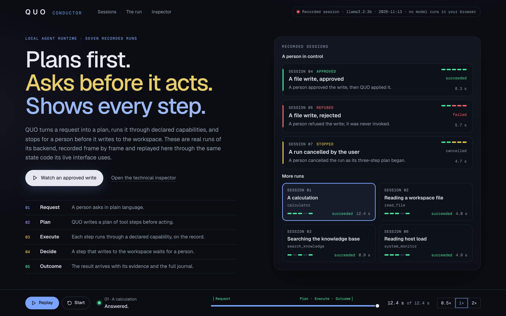
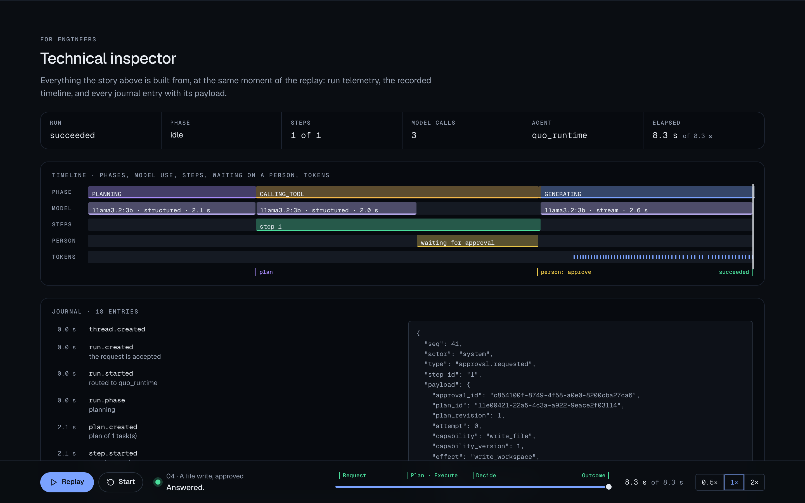
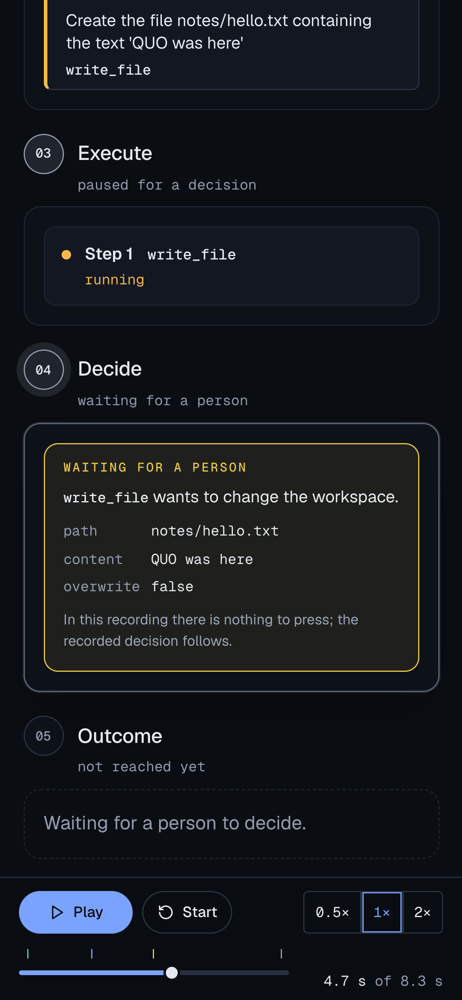
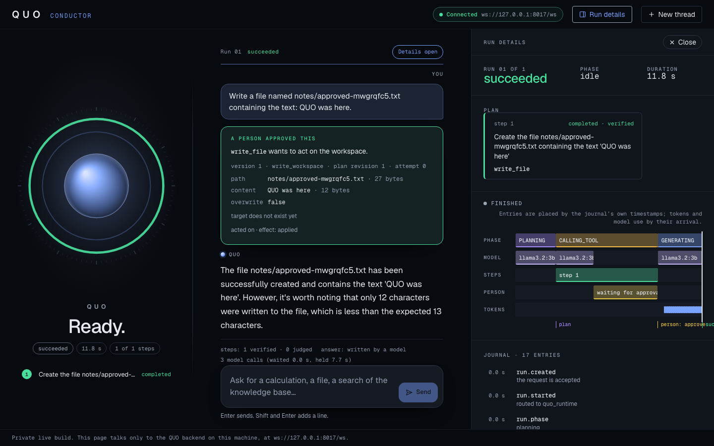
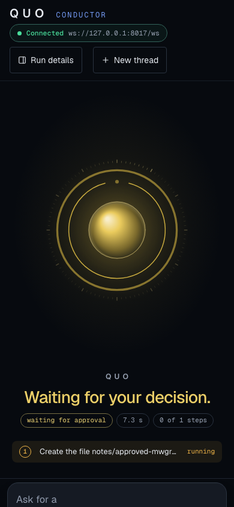

# QUO · Conductor

**[Open the demo](https://erturkeryavuz.github.io/quo-conductor-demo/)**

Recorded sessions of QUO, a local AI orchestration runtime, replayed from its own journal: what it planned, what it ran, what it asked a person to approve, and how each run ended.

This is a recording. No model runs in your browser, there is no prompt box, and the page makes no network connections.

## What QUO is

QUO turns a request into a plan, runs each step through a declared capability, and writes every event to a durable journal. A step that writes to the workspace stops and waits for a person, who approves or rejects exactly the action shown. Runs can be cancelled, and every outcome is recorded.

## What the demo shows

Seven sessions recorded from the real backend over its WebSocket protocol, with a small local model (`llama3.2:3b`) on a demo workspace:

- A file write that waits for a person and is **approved**, then applied.
- A file write that is **refused**: the step never runs and nothing is written.
- A run **cancelled** by the user as its three-step plan began; no step completed.
- A calculation, a file read, a knowledge-base search and a host-load reading, none of which needed an approval.

Each run is told as the same five stages: **request → plan → execute → decide → outcome**. The stages fill in as the replay reaches them, each with its recorded time, and the stage in progress is highlighted and kept in view while the session plays. Beside them, QUO's activity indicator follows the recorded phase: it turns amber while waiting for a person, green when a run is answered and red when it fails.

The screen at any moment is rebuilt by passing the recorded journal entries through the same state reducers that QUO's own interface uses, so what you see is derived from the record rather than drawn separately. Each session plays at its recorded timing; the bar at the bottom plays, pauses, restarts, changes speed and seeks.

The **technical inspector** below the story holds the evidence underneath: run telemetry, one time axis with the run's phases, model use, steps, time spent waiting for a person and streamed tokens, and the full journal, where any entry opens to its recorded payload.

A 37-second walkthrough: [`media/quo-walkthrough.mp4`](media/quo-walkthrough.mp4).

## Private Product Preview

The demo above is a replay of recorded sessions. QUO itself is a private application that runs on my own machine against its local backend; it is not publicly accessible, and nothing on this site connects to it.

These screenshots are of that private application, taken during real runs against the backend with the same local model. The figure on the left is QUO's activity indicator: its colour follows the phase the backend records, the outer ring has one segment per step of the plan, and the open ring means it is waiting for a person.

**A finished run, conversation first.** The request, QUO's answer, and what the journal records about the run.

**An approval request.** A file write stops before anything is changed; the person approves or rejects exactly the action shown, bound to its digest.

**After approval, with Run details open.** The recorded decision and effect, the plan, the time score and the journal.

**On a phone.**

## Limits

- The model is small and local. It handles single-tool requests well and longer plans less reliably. Answers are shown exactly as produced, including one odd remark in the approved-write session.
- The recording waits briefly before answering an approval, as a person would. Journal entries are placed by the backend's own timestamps.
- QUO is a local, single-user runtime. Cloud deployment and multi-user operation are outside its scope.

## About this repository

It holds only the built, static demo, its screenshots and a walkthrough video. QUO's source code is private.

Third-party licences: [THIRD-PARTY-NOTICES.md](THIRD-PARTY-NOTICES.md).

© 2026 Ertürk Eryavuz
