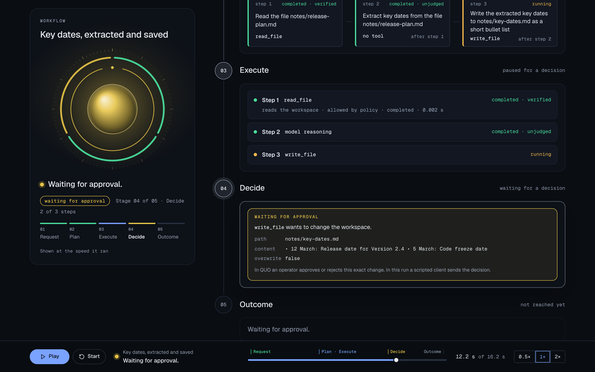
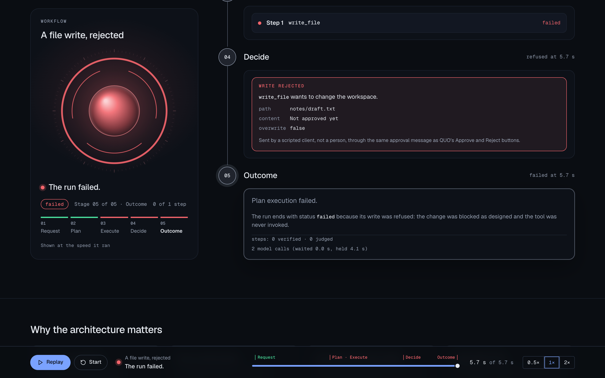
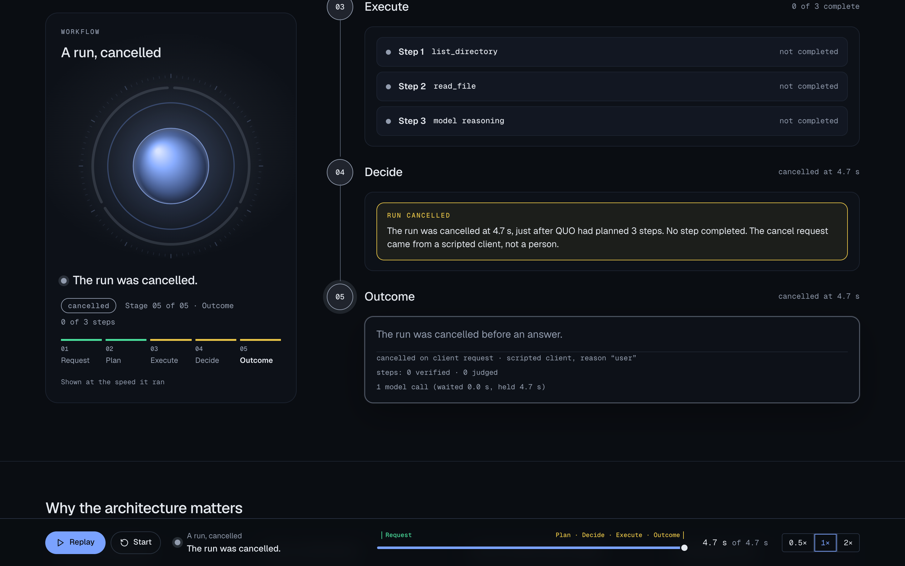
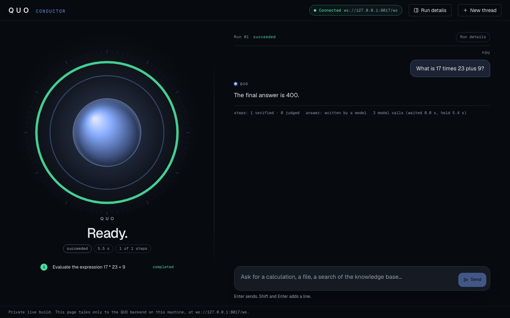

# QUO · Conductor

**QUO is a local AI orchestration runtime. It turns a request into planned tool steps, asks a person before it writes to the workspace, and journals every step so the work can be inspected afterwards.**

## **[→ Open QUO Conductor](https://erturkeryavuz.github.io/quo-conductor-demo/)**

[](https://erturkeryavuz.github.io/quo-conductor-demo/)

## Why it matters

A chat assistant can say what it would do. An agent that acts needs more:
- a plan you can read;
- tools that run within declared limits;
- a person's sign-off before anything changes;
- a record you can check afterwards.

QUO is built around those four things.

## What QUO does

- **Routes and plans.** Each request goes to the right handler. A task that needs tools gets a plan of steps with dependencies; a direct knowledge question is answered without one.
- **Runs declared capabilities.** Every tool step runs through a declared capability with an effect class, a permission and a time budget. Its outcome is recorded and, where the capability has a check, verified.
- **Passes results between steps.** A step receives the actual results of the steps it depends on.
- **Asks before workspace writes.** Reading files, searching knowledge, calculating and observing the host are allowed by policy. A write to the workspace waits until a person approves the exact action, bound to its digest; a refusal stops it. This rule cannot be switched off.
- **Lets a person cancel** a running request.
- **Journals everything.** Every phase, step, decision and outcome is written to a durable journal, and the interface is rebuilt from that journal.

## An end-to-end workflow

> Read notes/release-plan.md and write its key dates to notes/key-dates.md as a short bullet list.

1. **Plan.** QUO plans three steps: read the file, extract the key dates, write the result.
2. **Execute.** `read_file` reads the release plan, allowed by policy and verified. A model step extracts the dates from that result.
3. **Authorize.** `write_file` prepares the exact write (path, content, no overwrite) and stops for approval. The write is approved.
4. **Outcome.** The write runs and is verified, and the run succeeds in 16.2 s. The file in the workspace afterwards reads:

```
• 12 March: Release date for Version 2.4
• 5 March: Code freeze date
```




## Authorization and control

Refusal and cancellation are part of the design:

- **Refused write.** The write is not authorized, the tool is never invoked, and nothing is written. The run ends as `failed`, because a refused step cannot proceed. That is the protection working.
- **Cancelled run.** A three-step plan is cancelled just after it is created. No step completes, and the run ends as `cancelled`.

 

## Execution evidence

Below each workflow, the technical inspector shows what the page is built from, at the same moment of the run:
- telemetry;
- a timeline of phases, model use, steps, waiting for approval and streamed tokens;
- every journal entry with its payload, including exact capability names, grants, digests and tool results.


## Exploring the website

The website presents eight real runs of QUO's backend: the featured workflow, an approved write, a refused write, a cancellation, a calculation, a file read, a knowledge search and a host-load reading. You can play, pause, change speed, jump to any stage and open any journal entry.

The runs used a small local model (`llama3.2:3b`) on a demo workspace. In these runs, approvals, refusals and cancellations were sent by a scripted client through QUO's approval protocol, not by a person; the inspector says so for each run. Nothing executes in your browser: the page loads only its own files and connects to no backend.


## The private application

QUO itself runs privately on my own machine against its local backend. It is not publicly accessible, and its source code is private. These screenshots are from that application, during real runs with the same local model.




## Limitations

- **Answers come from the model.** The approvals, step checks and journal come from QUO's architecture; the answers come from the model and are limited by the small local model used. They are shown exactly as produced and can contain mistakes. A successful run means the steps ran and were checked, not that the model's wording is a verified fact. One answer, in the single approved write, contains such a mistake.
- **Plan length.** With this model, plans of one to three steps completed as asked; longer multi-file requests were less dependable.
- **Scope.** QUO is a local, single-user runtime. Cloud deployment and multi-user operation are outside its scope.

## About this repository

This repository holds the built website and its images. QUO's source code is private.

Third-party licences: [THIRD-PARTY-NOTICES.md](THIRD-PARTY-NOTICES.md).

© 2026 Ertürk Eryavuz
